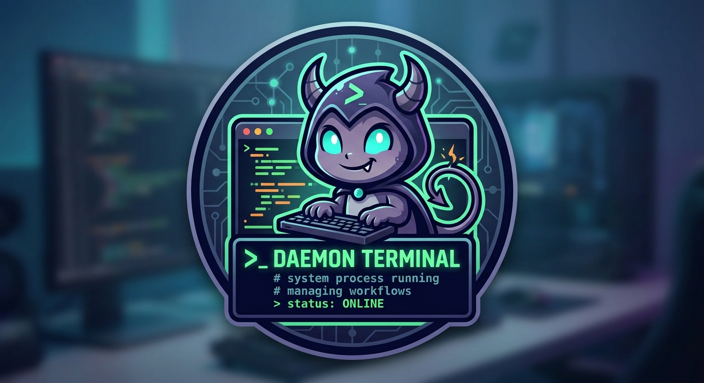

# Terminal

A sofware that helps me to resolve, make some $$$ and be at peace.
Also, skip a software deploy engineering. 

TODO: 
add this commands

[x] pomodoro, starts panel with pomodoro timer
[x] eisenhower, start 4 quad grid to clasify tasks 
[x] trello, opens trello
[x] github, opens github
[x] linkedin, opens linkedin
[x] indeed, opens Indeed
[x] talenteca, opens Talenteca
[x]  courses, add, update courses status
[ ] cv, configure skills, jobs etc -> generate cv yaml
[ ] agenda, configure events, store on sqlite
[x]  todo, enumerates incompleted tasks
[ ] plan, starts a plan
[ ] gantt
[ ] boss --status, manage multiple bosses
[x]  creed, prints the creed
[x] ai, opens chatgpt
[ ] journal, daily journal capture 
[ ] homework, manage homework dutties 
[ ] Better DDD for services

## INTERVIEW PROTIP

* Poner en cv que el contrato fue por proyecto

store tasks in sqlite database
permit more complex tasks (time span various days)

UX/UI for these commands:
ok client
ok chart

save clients on sqlite db

login
ok, show username on the command prompt

remove all front-end artifacts from API project
A sofware that helps me to resolve, make some tasks and be at peace.
