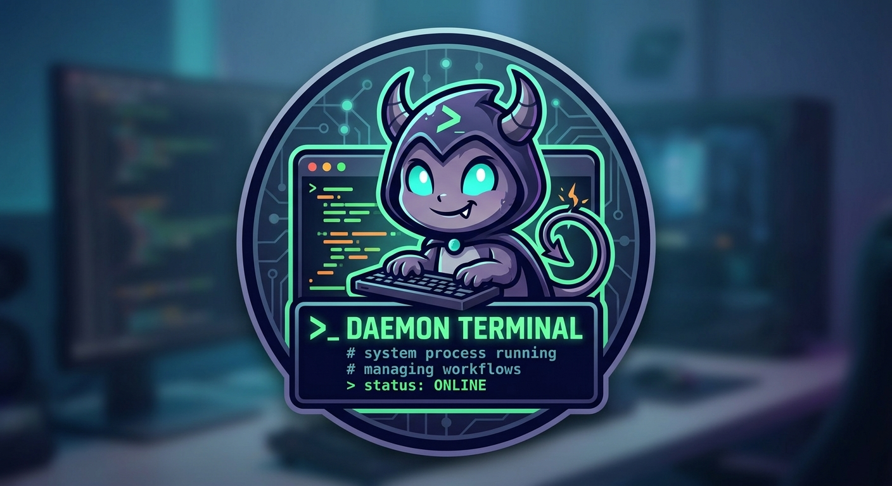

# Terminal

A sofware that helps me to resolve, make some $$$ and be at peace.

TODO: 
add this commands

* ok,pomodoro, starts panel with pomodoro timer
* ok,eisenhower, start 4 quad grid to clasify tasks 
* ok, trello, opens trello
* ok, github, opens github
* ok, linkedin, opens linkedin
* courses, add, update courses status
* cv, configure skills, jobs etc -> generate cv yaml
* agenda, configure events, store on sqlite
* todo, enumerates incompleted tasks
* plan, starts a plan
* gantt
* boss --status, manage multiple bosses
* creed, prints the creed
* ai, opens chatgpt
* journal, daily journal capture 

store tasks in sqlite database
permit more complex tasks (time span various days)

UX/UI for these commands:
ok client
ok chart

save clients on sqlite db

login
show username on the command prompt

remove all front-end artifacts from API project
A sofware that helps me to resolve, make some tasks and be at peace.
